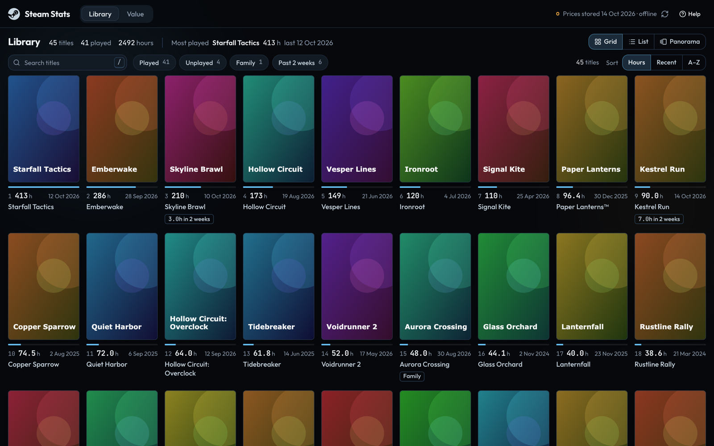
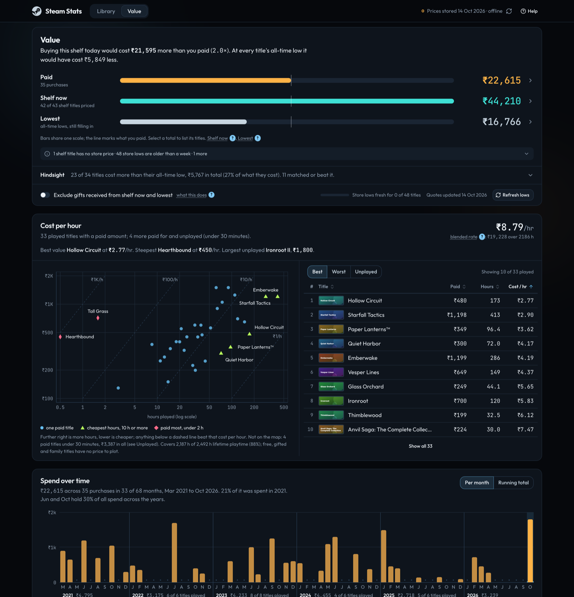
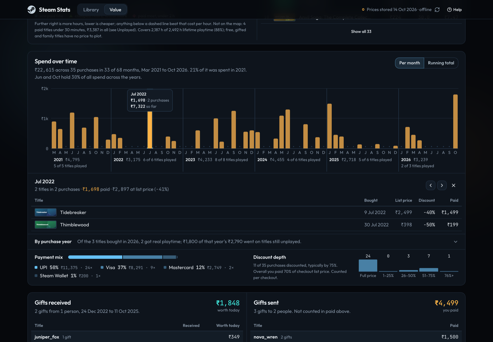
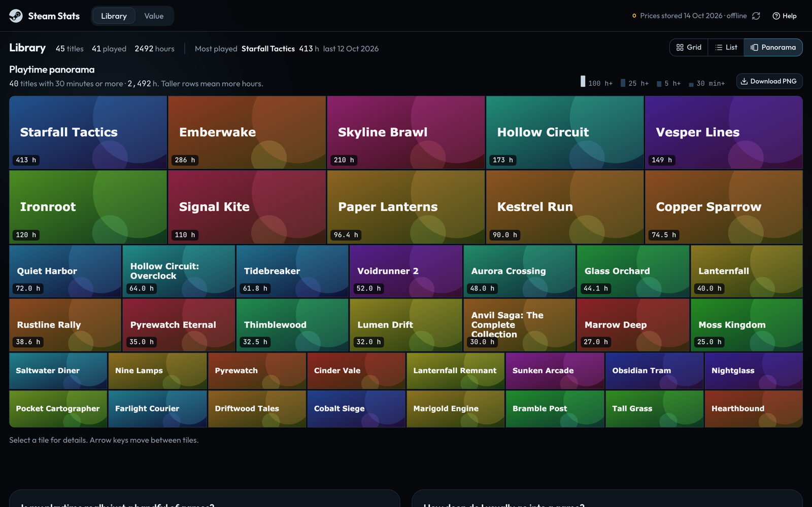
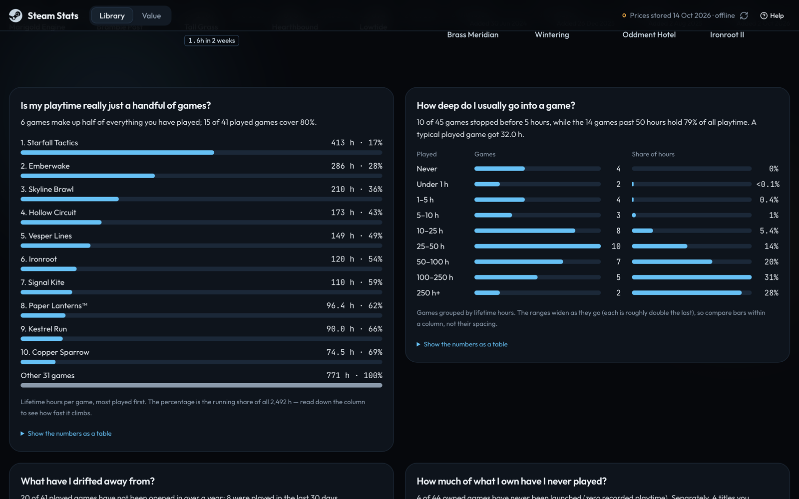
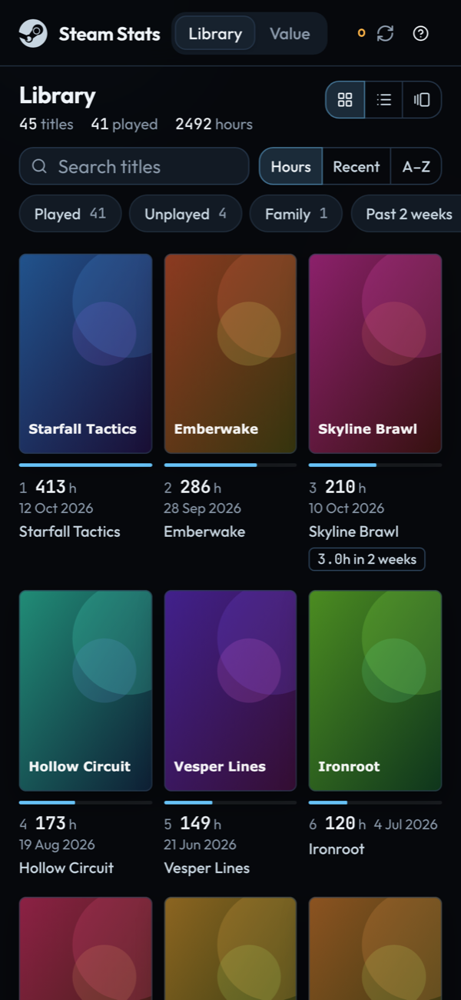

# Steam Stats

A local-only dashboard for your own Steam account: what you play, what you actually paid, and what the same shelf costs today. It runs on your machine, reads your own Steam Account Data, and has no hosted backend.



[](https://github.com/parthUltra/steam-stats/actions/workflows/ci.yml)
[](./LICENSE)


[Quick start](#quick-start) · [Privacy and security](#privacy-and-security-model) · [Limitations](#limitations) · [Troubleshooting](#troubleshooting)

Screenshots show a synthetic sample library (the test fixture in `tests/fixtures/library-a`), not a real account.

## What you get

Most Steam value calculators estimate spend from current store prices. Steam Stats reads your purchase history, so "paid" is the amount you were charged, net of refunds, with gifts, wallet top-ups and market activity kept apart.

- **Library**: every game as a card grid, a sortable list, or a playtime panorama (a wall of cover art sized by hours, downloadable as a PNG). Search, filter by played / unplayed / family library / past two weeks, and open any game for its playtime and money facts.
- **Value**: paid vs what the shelf costs now vs every title at its all-time low, cost per hour per game, spend over time, payment methods, discounts, and gifts sent and received.
- **Stats boards**: each one answers a single question, and says so in its title. See [the list below](#stats-boards).
- **Help drawer**: a glossary of every term on the page and the keyboard shortcuts, which you can switch off.

<table>
  <tr>
    <td width="50%"><br><sub>Paid vs shelf now vs all-time lows, then cost per hour with the value map.</sub></td>
    <td width="50%"><br><sub>Spend per month or as a running total. Select a month to see its purchases.</sub></td>
  </tr>
  <tr>
    <td><br><sub>Panorama: every title with 30+ minutes, tallest art is what you played most.</sub></td>
    <td><br><sub>Library stats boards, one question each.</sub></td>
  </tr>
</table>

<details>
<summary>Phone width</summary>



</details>

## Quick start

Requirements: Node.js 22 or newer, npm, macOS or Linux (Windows through WSL), and a Steam account.

```bash
git clone https://github.com/parthUltra/steam-stats.git
cd steam-stats
npm install
npm run launch
```

What `npm run launch` does, in order:

1. Installs Playwright's Chromium if it is missing, and copies `.env.example` to `.env.local` if you have none.
2. Opens a Chromium window on Steam's own login page. You sign in there (Steam Guard included); the app never sees your password. The window waits up to 10 minutes.
3. Saves your Account Data pages (purchase history, licenses, account spend, login history, games) to `samples/account-data/`. Steam Help may ask for your password a second time for two of those pages; enter it in the same window.
4. Parses those pages to JSON in `samples/parsed/` and fetches your full library with playtime.
5. Starts the dashboard on `127.0.0.1:3000` (loopback only, not reachable from your network) and opens <http://127.0.0.1:3000> in your default browser.

Press Ctrl+C in the terminal to stop the server. Run `npm run launch` again any time to refresh your data; the saved session is reused until Steam expires it.

Prices fill in after the first load: when the price cache is missing or more than a week old, the dashboard starts a background refresh. Current prices come from the Steam store. All-time lows need a free IsThereAnyDeal key, see [Optional setup](#optional-setup).

For exact per-game amounts in multi-item checkouts, run this once after launch (it reuses the saved session):

```bash
npm run fetch:transactions
```

## What it reads and where it is stored

Everything stays inside the project folder. All of these paths are gitignored.

| Path | What | Sensitivity |
|------|------|-------------|
| `.steam-session/storage-state.json` | Steam login cookies from the Chromium window | Bearer credential: whoever holds it is signed in as you |
| `.gmail-session/` | Isolated browser profile signed in to Gmail (only if you use Gmail gift sync) | Bearer credential |
| `data/itad-credentials.json` | IsThereAnyDeal API key pasted in the app | Secret |
| `.env.local` | Optional keys you set by hand | Secret |
| `samples/account-data/` | Raw Steam pages: purchase history, licenses, account spend, login history, games, transaction details | Personal: purchases, payment methods, Steam ID |
| `samples/parsed/` | The same data as JSON, plus the playtime snapshot | Personal |
| `data/gifts-received.json` | Gift titles, sender names and gift links from Gmail sync | Personal |
| `data/price-cache.json`, `data/artwork-cache.json`, `data/dlc-parents.json` | Store prices, cover art URLs, DLC-to-game map | Low: reveals which titles you own |
| `.price-refresh/` | Status and process id of the background price refresh | None |

The app creates credential and data files with mode `0600` and their directories with `0700`. To remove everything, delete the paths above.

## Privacy and security model

The app handles a Steam session and a full purchase history, so the server is built to answer only you.

What it defends against:

- **Other machines on your network.** `dev`, `start` and `launch` bind to `127.0.0.1`. A request whose `Host` header is not `localhost`, `127.0.0.1` or `[::1]` gets `403` on every route (`src/proxy.ts`), which also stops DNS rebinding.
- **Other websites open in your browser.** Every `POST` and `DELETE` requires a same-origin `Origin` or `Sec-Fetch-Site` header (`src/lib/http/same-origin.ts`). A Content Security Policy limits scripts, styles and connections to the app itself; the only external hosts allowed are Steam's image CDNs. Framing is denied.
- **Leaks through the API.** Responses never include the IsThereAnyDeal key, session cookies, gift redemption links or process ids. Error responses carry a fixed message; details go to the server log.
- **Other users on a shared machine.** Credential, session and data files are owner-only.
- **Data leaving your machine.** The app has no telemetry and no hosted backend. Outbound requests go only to Steam, IsThereAnyDeal (if you add a key) and Gmail (if you start a gift sync, in its own browser window). The Next.js CLI collects its own anonymous usage data by default; turn it off with `npx next telemetry disable`.

What it does not protect against:

- Anyone or anything running as your user account on this machine can read the files above and reach the server. There is no login on the dashboard.
- `.steam-session/` and `.gmail-session/` are bearer credentials. Do not copy, sync or back them up anywhere you would not put a password.
- Screenshots of your own dashboard show your purchases. Check before sharing.

The full threat model is in [docs/security.md](docs/security.md). To report a vulnerability, see [SECURITY.md](SECURITY.md).

## Optional setup

**IsThereAnyDeal key (all-time lows).** On the Value tab choose **Get store lows**, register an app at <https://isthereanydeal.com/apps/>, and paste the key. It is saved to `data/itad-credentials.json` and nowhere else. Without a key, "Lowest" falls back to the current price and the page says so. `ISTHEREANYDEAL_API_KEY` in `.env.local` is still read as a fallback when no key is saved in the app.

**Gmail gift sync.** Steam's license list does not always say who gave you a game. On the Value tab, **Sync from Gmail** opens a separate browser window with its own profile, you sign in to Gmail there, and the app reads Steam gift emails into `data/gifts-received.json`. No mail password is stored. The same sync is available as `npm run sync:gifts-gmail`.

**Steam Web API key.** Not used. The library fetch uses the access token from your Steam session, which (unlike a Web API key) can also read your Steam Family Library.

**Region.** Prices use your Steam store country and currency, detected from your purchase history and login history. If neither is available it falls back to US / USD.

## Using the dashboard

The tab, sort, view, filters, search text and open game are kept in the URL, so the back button and bookmarks work.

| Key | Action |
|-----|--------|
| `1` or `L` | Library |
| `2` or `V` | Value |
| `/` | Search the shelf |
| `H` / `R` / `A` | Sort by hours / recent / A–Z |
| `G` / `T` / `P` | Grid / list / panorama view |
| `Esc` | Close a dialog, or clear the search |

Single-key shortcuts can be turned off in the Help drawer.

### Stats boards

Library tab:

| Board | Question it answers |
|-------|---------------------|
| Playtime concentration | Is my playtime really just a handful of games? |
| Playtime distribution | How deep do I usually go into a game? |
| Dormancy | What have I drifted away from? |
| Backlog | How much of what I own have I never played, and what did it cost? |
| Hours by source | Do I play what I buy, what I am given, or what I borrow? |
| Library growth | How did my library build up? |

Value tab (folded into the Value, cost per hour and spend boards):

| Board | Question it answers |
|-------|---------------------|
| Value map | Which games earned their price? Paid against hours, per game. |
| Paid vs all-time low | How far above or below the lowest recorded price did I buy? |
| Running total | How did spend accumulate, and which year carried most of it? |
| Purchase cohorts | Did each year's purchases get played? |
| Discount depth | How deep were the discounts I bought at? |
| Month grid | Which calendar months hold most of the spend? |

A board is hidden or reduced to a sentence when the data cannot support it. For example, library growth is not drawn when fewer than three quarters of your games have a known acquisition date.

## Scripts

| Script | What it does |
|--------|--------------|
| `npm run launch` | Steam login, fetch, parse, library fetch, start the dashboard, open the browser |
| `npm run launch:fast` | Same as `launch`, but skips the price refresh (the launch step and the dashboard's automatic weekly refresh). **Refresh lows** in the app still works |
| `npm run dev` | Development server on `127.0.0.1:3000` |
| `npm run build` | Production build |
| `npm start` | Serve the production build on `127.0.0.1:3000` |
| `npm run fetch:account-data` | Open Steam login (or reuse the session), save Account Data pages, fetch the library |
| `npm run parse:account-data` | Parse saved pages into `samples/parsed/*.json` |
| `npm run fetch:owned-games` | Refresh library and family-library playtime with the saved session |
| `npm run fetch:transactions` | Fetch per-purchase detail pages for exact per-game amounts |
| `npm run refresh:prices` | Refresh `data/price-cache.json`, then the DLC and artwork caches |
| `npm run sync:gifts-gmail` | Import Steam gift emails from Gmail |
| `npm run typecheck` | `tsc --noEmit` |
| `npm run lint` | ESLint, zero warnings allowed |
| `npm test` / `npm run test:unit` | Unit tests in `src/**/*.test.ts` |
| `npm run test:integration` | Whole pipeline against the synthetic fixture, offline |
| `npm run test:security` | Host, origin, secrets, SSRF and offline checks |
| `npm run test:e2e` | Browser tests against a production build of the fixture |
| `npm run test:all` | The four test gates in order |
| `npm run verify` | Typecheck, lint, then `test:all` |
| `npm run fixture:build` | Regenerate the synthetic fixture |
| `npm run audit:deps` | `npm audit` for production dependencies, high severity and above |

Both the Next.js server and the terminal scripts read `.env.local`.

## Testing

```bash
npm run verify
```

`verify` runs typecheck and lint, then four test gates. CI runs the same steps on every push to `main` and every pull request.

| Gate | Command | What it proves |
|------|---------|----------------|
| Unit | `npm run test:unit` | Parsers, analytics and stats on small synthetic inputs |
| Integration | `npm run test:integration` | The full dashboard payload matches totals worked out by hand, is deterministic, writes nothing and fetches nothing |
| Security | `npm run test:security` | Host allow-list, origin guard, key handling, artwork proxy, no secrets in responses or in git |
| Browser | `npm run test:e2e` | The real pages in Chromium: dashboard, library, help drawer, accessibility basics |

All gates run offline against `tests/fixtures/library-a`, an invented account with 45 made-up games. Its [README](tests/fixtures/library-a/README.md) shows how every expected total was derived by hand. Tests never read your real data.

To look at the app with the fixture instead of your own account:

```bash
node tests/prepare-root.mjs
STEAM_STATS_ROOT=.test-root STEAM_STATS_OFFLINE=1 npm run dev
```

`STEAM_STATS_ROOT` points the app at a different data folder. `STEAM_STATS_OFFLINE=1` blocks every outbound request and child process.

## Limitations

- **No playtime over time.** Steam exposes lifetime minutes, the last two weeks, and a last-played date. Hours per month or per year cannot be computed from that, so the app does not show them.
- **"Paid vs all-time low" is hindsight.** It compares what you paid with the lowest price on record, whenever that low happened, including after you bought.
- **Not yet run against live Steam since the rebuild.** License-list pagination, purchase-history "load more", and the changes to the price refresh script are covered by unit tests on synthetic HTML. They have not been exercised against the real site since they were rewritten. The dashboard flags a source it could only partly read (data notes on the Value tab), so check those after your first fetch.
- **Sessions expire.** When Steam ends your session, run `npm run fetch:account-data` and sign in again.
- **Prices are regional and need sources.** Current prices come from the Steam store for your detected country. All-time lows need an IsThereAnyDeal key and cover the Steam store only. Titles with no store price in your region are left out of the shelf totals and listed as unpriced.
- **Key activations have no price.** A game redeemed from a key bought elsewhere has no purchase row, so it counts as owned but not as paid.
- **Snapshot, not live.** Playtime is as of your last fetch. Boards that measure time say which date they measure from.
- **File modes are POSIX.** The owner-only permissions do not apply on a native Windows filesystem.

## Troubleshooting

| Symptom | Cause and fix |
|---------|---------------|
| `No Account Data found. Run: npm run fetch:account-data && npm run parse:account-data` | Nothing has been fetched yet. Run `npm run launch`, or the two commands in the message. |
| Data note: "… needs a re-fetch (Steam asked for a login)" | The session expired, or Steam Help wanted your password again and a login page was saved instead of the data. Run `npm run fetch:account-data`, enter the password in the window when asked, then `npm run parse:account-data`. |
| Data note: "Licence list is only partly fetched" | Only some pages of the list were saved. Run `npm run fetch:account-data` again and let it finish, then `npm run parse:account-data`. |
| "Partial library" hint on the Library tab | Playtime came from the short Account Data games page. Run `npm run fetch:owned-games` with a valid session. |
| `Timed out waiting for Steam login.` | The login window waits 10 minutes. Run the command again. |
| `No Steam session found. Run: npm run fetch:account-data (log in once)` | `.steam-session/` is missing. Run that command. |
| Data note: "Price cache is unreadable … a backup exists at data/price-cache.json.bak" | The file is corrupt and was left untouched. Restore with `cp data/price-cache.json.bak data/price-cache.json`, or delete it to start empty. The same applies to `data/gifts-received.json`. |
| `403 Forbidden host` | You opened the app by LAN address or another hostname. Use `http://127.0.0.1:3000` or `http://localhost:3000`. |
| `403 {"error":"Forbidden"}` on a `POST` or `DELETE` from a terminal | Send the origin: `curl -X POST -H 'Origin: http://127.0.0.1:3000' http://127.0.0.1:3000/api/refresh-prices` |
| "Lowest" equals "Shelf now", note says store lows are not connected | Add an IsThereAnyDeal key with **Get store lows**. |
| `Paste a valid IsThereAnyDeal API key.` | The key must be 16 to 128 letters, digits, `_` or `-`. Copy it again without line breaks. |
| Playwright cannot find a browser | `npx playwright install chromium` |
| `Server did not become ready at http://127.0.0.1:3000` | Something else holds port 3000. Stop it and run `npm run launch` again. |

## Contributing

See [CONTRIBUTING.md](CONTRIBUTING.md). For how the code is laid out and how data flows from fetch to render, see [docs/architecture.md](docs/architecture.md). Changes are listed in [CHANGELOG.md](CHANGELOG.md).

## License

MIT, see [LICENSE](./LICENSE). Steam Stats is not affiliated with Valve or IsThereAnyDeal.
